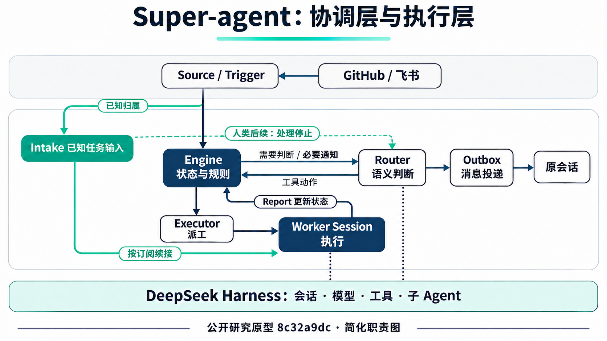
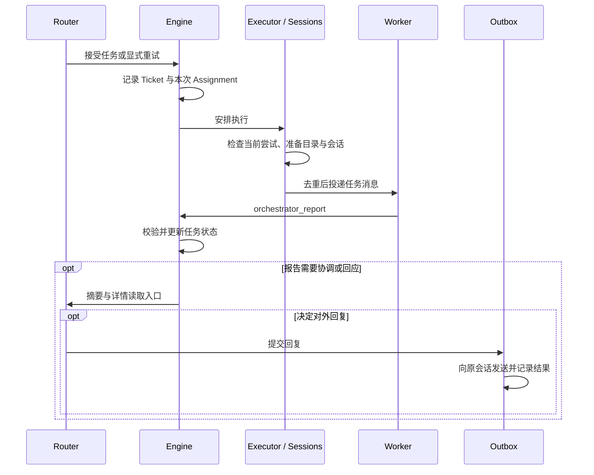
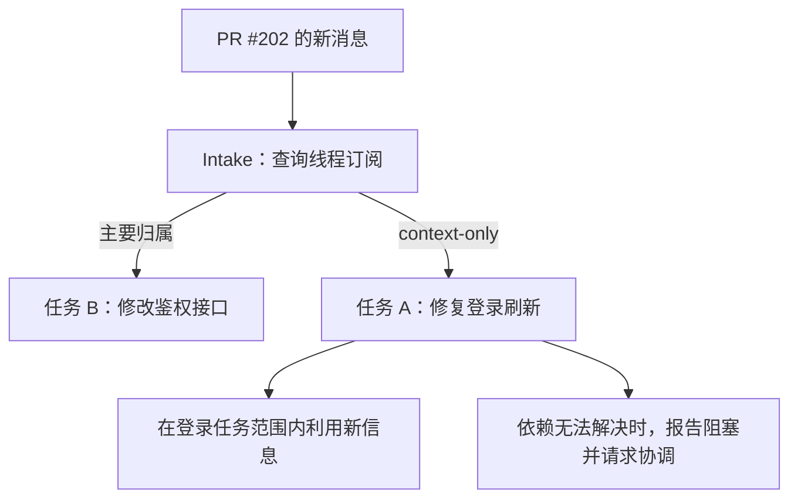

我最初关注 Super-agent，是想了解模型路由：一个请求来了，系统怎样选择合适的模型，什么时候需要多个 Agent？但随着问题逐渐具体，我发现应该先弄清楚另一件事：当多个任务同时运行，谁来负责判断消息归属、保存执行状态，以及决定什么时候需要人介入？

这也是我觉得它和 dot 有一点相似的地方。用户可以通过一个统一入口交代工作，内部则有多个任务会话分别推进。不过，入口统一只是表面。真正值得分析的是，内部怎样把这些会话组织成可以持续工作的系统，而不是最后仍然让人逐个检查、转发消息和协调依赖。

本文围绕这个问题展开。先确定 Super-agent 与 Harness 的分工，再沿着一项代码修改的生命周期，看任务如何建立、执行、协作和交付，最后讨论上下文控制、可靠性与评测边界。我的理解是：**这套设计的重点，在于让任务身份、执行过程和信息归属都有明确的记录，从而减少人反复协调的工作。**

> 分析范围：公开研究原型 `dsh-superagent-prototype`，固定提交 `8c32a9dc`。本文依据文档与静态源码整理，没有运行该系统的性能实验。[README](https://github.com/deepseek-ai/dsh-superagent-prototype/blob/8c32a9dc5d72c033816c6a8110b37f40cf94fba4/README.md) 明确说明：它不是 DeepSeek 官方产品；公开代码与团队内部版本、设计文章中的实现并不完全相同，部分设计仍是未来方向。
{: .prompt-info }

## 一、从并行执行到持续协作

先考虑一个具体场景：一个 Worker 正在修复登录刷新失败，另一个 Worker 正在修改鉴权接口。两件事起初分别推进，随后登录任务发现自己依赖鉴权接口的新行为。与此同时，用户补充了复现条件，鉴权 PR 收到了评论，登录 Worker 又报告了阻塞。

执行这些工作的 Agent 可以并行运行，但协调问题没有因此消失。新消息属于哪个任务？登录任务是否需要看到鉴权 PR 的变化？受阻之后是等待补充，还是发起新一轮执行？哪条信息值得打断人？

如果这些判断最终都交给用户，多 Agent 增加的执行能力，就会伴随更多的注意力消耗。Super-agent 把其中一部分工作交给协调层：接收外部事件，建立任务归属，维护授权范围和执行状态，再把需要处理的信息送到适当的会话。

这里需要先区分任务路由与模型路由。前者判断“这条消息该由谁、在哪件事的范围内处理”；后者判断“这次推理使用哪个模型”。公开原型的 Router 主要承担前者。它支持按角色配置模型，但不能因此推断出一个按任务难度自动选择大小模型的机制。

减少人工协调也不等于扩大 Agent 的行动范围。项目的原则是：被请求或被团队规则允许时才行动，只有人需要行动或结果确实有用时才发言。能否自主执行、应不应该执行、是否需要通知人，是三个需要分别处理的问题。

## 二、整体架构：协调层建立在 Harness 之上

理解运行方式时，我觉得“Worker 相当于 Harness 的一个对话”是一个有用的入口。它说明了上下文如何分开，但还没有解释任务状态由谁管理。把系统分成两层，就比较容易看清这一点。

**Harness 提供执行能力。** 模型调用、工具循环、会话、工作区和子 Agent 等能力，由 DeepSeek Harness 承担。

**Super-agent 组织持续工作。** 它处理外部消息、任务归属、授权、调度、报告和对外回复。Router 和 Worker 都使用 Harness 的能力，但各自承担不同职责。

_公开原型的主要关系。箭头表示信息或调度关系，不是所有事件都要依次经过的固定流水线。_

[插件入口](https://github.com/deepseek-ai/dsh-superagent-prototype/blob/8c32a9dc5d72c033816c6a8110b37f40cf94fba4/src/index.ts) 取得宿主服务，[Runtime](https://github.com/deepseek-ai/dsh-superagent-prototype/blob/8c32a9dc5d72c033816c6a8110b37f40cf94fba4/src/app/runtime.ts) 再装配 Engine、Sessions 和 Executor。创建 Worker 时，[Sessions](https://github.com/deepseek-ai/dsh-superagent-prototype/blob/8c32a9dc5d72c033816c6a8110b37f40cf94fba4/src/app/sessions.ts) 使用宿主的会话控制与工作区能力。因此，公开原型在这里采用的是插件与宿主服务集成，并非每派一次工都调用一个外部 Harness 命令行进程。

协调层内部也有分工。Router 处理需要语义理解的判断，例如一条请求是否属于已有任务；Engine 则用确定性的代码检查状态与约束，记录动作结果。Executor 负责把执行安排落实到 Worker 会话。模型负责提出某个动作，程序仍要确认这个动作在当前状态下能否执行。

这解释了为什么 Super-agent 不能简单等同于“一个任务路由 Agent”。只有 Router，系统可以决定把事情交给谁，却还缺少任务恢复、消息投递和结果交付的管理。后面的生命周期，正是这些组件存在的原因。

“统一入口”的类比也有边界。公开原型会接入 GitHub，也可以接入飞书，并回到原会话回复。它提供统一的协调方式，但并不要求所有工作都进入唯一一个聊天窗口。

## 三、任务生命周期：把一件事与一次执行分开

回到登录修复。用户明确提出这项需求之后，系统需要先决定它是新工作，还是已有工作的补充。这个判断决定了信息将进入哪段长期上下文，也决定了后续动作依据什么授权。

### 建立任务归属

[dispatch 提示词](https://github.com/deepseek-ai/dsh-superagent-prototype/blob/8c32a9dc5d72c033816c6a8110b37f40cf94fba4/prompts/dispatch.md) 对关联已有任务采取保守策略。明确的 PR、Issue 或来源引用，能够唯一识别的已有工作，都比“内容看起来类似”更可靠。把两个相似却独立的需求错误合并，会同时混淆上下文与授权范围。

因此，Router 做的是带有规则约束的语义判断，而不是调用一个已经训练好的通用“任务相似度分类器”。Engine 能检查动作是否合法，却不能替模型保证语义判断永远正确。

一旦登录修复被接成任务，接下来需要区分三个对象：

| 对象 | 保存什么 | 为什么需要单独存在 |
| --- | --- | --- |
| Ticket | 长期任务身份及其工作范围 | 后续消息和结果需要知道自己属于哪件事 |
| Assignment | 本次执行尝试的身份与状态 | 重试、过期回调和重复投递需要区分 |
| Worker Session | 已有对话与执行上下文 | 执行尝试变化时，可以继续使用积累的上下文 |

我最初对 Assignment 的疑问是：既然已经有 Ticket 和 Worker Session，为什么不能直接把两者连接起来？

在只执行一次、没有失败的简单场景里，直接连接确实可以工作。问题出现在异步执行和重试之后。假设登录任务为 T1，首次执行为 A1。A1 报告受阻，随后 Router 显式发起重试，系统结束 A1 并建立 A2。任务仍是 T1，会话也可能继续复用，但当前执行者已经变了。

此时，如果属于 A1 的启动或投递步骤在 await 之后返回，仅凭 Ticket ID 无法判断这一步是否已经过期，因为 A1、A2 都属于 T1。Assignment 给调度代码提供了更细的身份，可以检查它是否仍对应当前尝试。这不是包住所有业务工具回调的通用保护。

这里的“显式重试”很重要。`blocked` 报告本身不会自动结束 Assignment；收到补充信息后继续工作，也可能仍在 A1 内。Assignment 划分的是执行尝试，并非每来一条新消息就新建一轮。[Ticket 调度](https://github.com/deepseek-ai/dsh-superagent-prototype/blob/8c32a9dc5d72c033816c6a8110b37f40cf94fba4/src/core/tickets.ts) 与 [Executor](https://github.com/deepseek-ai/dsh-superagent-prototype/blob/8c32a9dc5d72c033816c6a8110b37f40cf94fba4/src/executor/dsh.ts) 共同实现了这部分逻辑。

### 从派工到结果交付

建立 Assignment 之后，系统还要准备工作目录、确保会话存在，再把任务消息投递进去。整个过程可以沿着下面这条链路理解：

[Worker 启动代码](https://github.com/deepseek-ai/dsh-superagent-prototype/blob/8c32a9dc5d72c033816c6a8110b37f40cf94fba4/src/executor/dsh.ts#L424-L469) 不只是在顺序调用几个接口。准备目录、等待旧运行结束、创建会话都可能耗时，期间任务可能已经停止或重试。因此，在关键异步步骤之后，要重新检查当前 Ticket 和 Assignment 是否仍然有效。

投递也需要区分第一次说明与后续增量，并用稳定的消息身份检查历史和 inbox，减少重复派工。消息被会话接受，只表示执行可以开始。任务是否完成，要看实际工作和后续报告。

Worker 通过 [`orchestrator_report`](https://github.com/deepseek-ai/dsh-superagent-prototype/blob/8c32a9dc5d72c033816c6a8110b37f40cf94fba4/src/app/tools/executor.ts#L72-L102) 提交结构化结果。该工具支持 `progress`、`ready`、`blocked`、`failed`、`dropped` 五种报告状态，还可以附带摘要、需要人处理的问题、关联 PR 或正在回应的输入。这些是报告状态，不能直接当作 Ticket 或 Assignment 的全部生命周期状态。

报告进入 Engine 后，普通进度可以只作内部记录；需要协调或回应的内容，再通过 [报告转交通知](https://github.com/deepseek-ai/dsh-superagent-prototype/blob/8c32a9dc5d72c033816c6a8110b37f40cf94fba4/src/app/notices.ts#L107-L128) 送给 Router。Router 仍需要决定是否回复，最后由 Outbox 实际发送。

这一段让我更清楚地理解了“完成”的含义。Worker 提交报告、Router 处理报告、用户收到结果，是三个不同的完成点。尤其是 `ready`，可以表示成果已准备好供评审，并不意味着后续 PR 流程也已结束。

## 四、跨任务协作：共享信息，不混合任务身份

独立会话解决了上下文相互干扰的问题，但登录和鉴权的例子又提出了相反的需求：任务之间确实存在依赖，信息不能完全隔绝。

假设鉴权任务 B 对应 PR #202，登录任务 A 的 Worker 读代码后发现，自己的修复依赖这个 PR 的接口变化。此时不必因为代码同时涉及 A、B 两个模块，就新建一个“AB Worker”。Worker 对应的是任务，而不是固定代码模块。

如果 A 需要持续关注 PR #202，可以通过 `orchestrator_thread_follow` 建立上下文订阅。订阅工具绑定当前任务，[followForContext](https://github.com/deepseek-ai/dsh-superagent-prototype/blob/8c32a9dc5d72c033816c6a8110b37f40cf94fba4/src/core/tickets.ts#L402-L421) 记录关联关系；后续消息再由 [Intake](https://github.com/deepseek-ai/dsh-superagent-prototype/blob/8c32a9dc5d72c033816c6a8110b37f40cf94fba4/src/core/intake.ts#L30-L59) 按订阅分发。

两边都收到消息，但收到消息的意义不同。B 是主要归属，A 获得的是背景上下文。A 可以利用接口变化继续修复登录，却不会因为订阅了一条线程，就获得代替 B 处理全部鉴权需求的权限。

同样，A 如果需要协调，可以报告依赖或阻塞，但不能把自己看到的 B 的输入当成自己拥有的消息，随意 handback 后重新派工。订阅也不自动回放该线程的全部历史，更不会无条件唤醒已经结束的任务。

我认为这里值得保留的区分是：任务之间可以共享信息，同时保持独立的责任与授权。把它们直接合并成一个大任务，虽然看起来省去了信息转发，却可能把原本清楚的边界一起合并掉。

在已有订阅关系的情况下，投递也不必每次经过 Router 重新决定。Intake 可以直接把信息送给 Worker。人类后续消息仍可能通知 Router，以便处理停止请求；旁路的是重复路由决策，而不是保证 Router 永远看不到这条消息。

一次临时补充和持续订阅也有区别。Router 的任务 note 可以传递一段相关信息，但它不会建立长期跟随关系，也不能代替新的授权。

### 两种多 Agent，不同层面的分工

到这里，可以把任务 Worker 与子 Agent 区分开。多个 Ticket 的 Worker，分别承担不同工作的生命周期；一个 Worker 再启动子 Agent，则是在一项工作内部委派子任务。两者不需要一一对应，公开原型也没有一个通用复杂度阈值，能机械地决定什么时候必须拆出更多 Agent。

通信方式随层次不同而变化。Super-agent 的协调路径使用应用状态、报告工具、会话投递和 inbox；Worker 内部的子 Agent 协作使用 Harness 的管理与消息能力。在本文检查的主要路径中，它们并不是通过标准 A2A 协议交换任务。理解这里的通信，先看消息在哪一层、由谁拥有，比先套一个协议名称更有帮助。

## 五、长期运行：控制上下文，也控制过期动作

前面的流程说明任务如何运转，但还没有回答它为什么能持续运转。随着任务增多、历史变长，协调层会面对两类压力：一类是模型要处理的信息越来越多，另一类是并发与恢复带来的状态越来越复杂。

### 上下文控制从减少重复决策开始

如果 Router 必须接收每个 Worker 的全部执行记录，那么独立会话只是在暂时推迟上下文膨胀。公开原型采用了更有选择的信息流。

已经有明确归属的后续输入，优先投递到已有任务，减少重新决策。确实需要 Router 判断的输入，则先整理成候选卡，提供来源、相关任务、交回原因以及进一步读取的入口。Router 不需要一开始就读完所有 PR 评论与工具输出。

执行细节留在各自 Worker 的会话，报告回流时主要带摘要、状态与必要的读取指针。这样，Router 能掌握任务之间的关系，又不必成为所有执行日志的副本。

这些方法仍然不能阻止会话历史增长。[Harness 配置](https://github.com/deepseek-ai/dsh-superagent-prototype/blob/8c32a9dc5d72c033816c6a8110b37f40cf94fba4/cordis.patch.yml) 因此还启用了历史压缩与工具结果裁剪。两者处理的对象不同：历史压缩整理较早的对话，工具结果裁剪减少过长工具输出占用的空间，不能把裁剪配置误认为整个上下文窗口或用户消息的统一长度限制。

[提示词组装](https://github.com/deepseek-ai/dsh-superagent-prototype/blob/8c32a9dc5d72c033816c6a8110b37f40cf94fba4/src/app/prompts.ts) 还把相对稳定的角色规则与动态策略组织起来，减少不必要的前缀变化。这有利于前缀复用，但实际缓存命中率和成本收益仍需测量。

另一个容易混淆的是分页读取缓存。[sourcePage](https://github.com/deepseek-ai/dsh-superagent-prototype/blob/8c32a9dc5d72c033816c6a8110b37f40cf94fba4/src/app/resources.ts#L103-L108) 在 `offset = 0` 时重新获取资源，并刷新同一 Session、同一资源对应的缓存；后续页通常读取当前快照。缓存失效后，需要从 `offset = 0` 重读。它既不是永不变化的分页快照，也不是模型推理服务的 KV Cache。

这些机制共同作用，才构成上下文管理：能避免的重复判断先避免，执行记录分开保存，细节按需读取，剩余的长历史再交给宿主治理。

### 可靠性依赖明确的执行身份

另一类问题与模型上下文无关。即使 Router 的判断完全正确，异步回调、重启和重试也可能让动作执行错位。

Assignment 检查用来识别旧执行；[Delivery](https://github.com/deepseek-ai/dsh-superagent-prototype/blob/8c32a9dc5d72c033816c6a8110b37f40cf94fba4/src/app/delivery.ts) 用消息身份与历史、inbox 检查减少重复投递；[Effects](https://github.com/deepseek-ai/dsh-superagent-prototype/blob/8c32a9dc5d72c033816c6a8110b37f40cf94fba4/src/app/effects.ts) 将待执行效果持久化，并通过序号、代际等条件确认完成，避免旧回调删除后来更新过的效果；[Outbox](https://github.com/deepseek-ai/dsh-superagent-prototype/blob/8c32a9dc5d72c033816c6a8110b37f40cf94fba4/src/app/outbox.ts) 则跟踪外部发送的排队与结果。

这些细节解释了为什么任务调度不能只靠一段提示词和几次工具调用。模型可以决定“继续这个任务”，但系统必须分清到底继续哪一次执行，哪些消息已经投递，哪些外部动作仍未完成。

它们仍有明确边界。去重与状态检查不等于已经证明分布式 exactly-once；忽略过期回调，也不能撤回已经发生的外部副作用。类似地，任务工具绑定、授权检查和独立工作目录，并不提供操作系统级安全隔离。[部署文档](https://github.com/deepseek-ai/dsh-superagent-prototype/blob/8c32a9dc5d72c033816c6a8110b37f40cf94fba4/docs/006-deployment.md) 明确提醒预设以操作者的 OS 用户运行，默认使用 `danger-full-access`。

从工程角度看，这些是让系统更可检查、更容易恢复的措施。是否足够安全，仍取决于它实际拿到了什么工具权限，以及被部署到什么环境。

## 六、如何评价这套设计

我对 Super-agent 的兴趣，最终还是要回到一个实际问题：增加了这些对象和状态管理之后，它是否真的能减少人的负担，提高任务完成质量？

源码能说明机制存在，测试能说明部分程序行为符合预期，但它们还不能直接回答这个问题。仓库的测试覆盖任务状态、后续输入、并发和模型配置等行为，`pnpm check` 提供类型检查、测试与构建。这些验证很重要，却不能证明真实模型总能正确选择新建或关联任务，也不能证明最终代码一定正确。

项目[设计文章](https://x.com/DeepSeekHarness/status/2116857257245987236)还报告了模拟负载下的架构对照与内部使用；这里的文章信息经[全文镜像](https://threadnavigator.com/thread/2116857257245987236/)核查，原 X 正文在本次访问中受限。对此需要保留两层区分：模拟协调表现与真实编码质量不同，文章描述的系统与公开原型也不完全相同。仅凭这些材料，还不足以得出整体上优于同类产品的结论。

一个更有说服力的比较，需要在相近模型、工具权限、任务集和预算下，观察任务完成率与返工率，统计错误关联、重复执行和信息遗漏，并记录人工介入次数、无效通知和故障恢复耗时。端到端耗时与总成本也要一起看，而不只是某一类 token 或某一次任务的速度。

这些机制能否帮助小模型，也是待验证的问题。职责更清楚、上下文更集中，可能降低模型负担；但公开原型的按角色模型配置，并不是按难度自动选模。在本文核查范围内，也没有足够证据支持专门蒸馏、LoRA 或强弱模型自动升级已经带来明确收益。

因此，我现在更愿意把 Super-agent 看作一个值得研究的协调系统原型。它将许多原本隐含在对话里的东西明确记录下来：任务属于谁、当前是哪次执行、信息为什么送到这里、结果是否已经交付。这样才能在多个任务持续推进时，尽量少让人重复处理这些关系。

这也改变了我最初看模型路由问题的顺序。在考虑用哪个模型、启动几个 Agent 之前，先把任务身份、授权和信息流组织清楚，后续的模型选择和并行执行才有一个稳定的落点。至于这套复杂度是否值得，需要用具体工作中的效果来回答。

## 源码阅读路径

本文引用的 Super-agent 源码均固定到 `8c32a9dc`。如果继续深入，可以按以下顺序阅读：

1. [README](https://github.com/deepseek-ai/dsh-superagent-prototype/blob/8c32a9dc5d72c033816c6a8110b37f40cf94fba4/README.md) 与 [领域模型](https://github.com/deepseek-ai/dsh-superagent-prototype/blob/8c32a9dc5d72c033816c6a8110b37f40cf94fba4/docs/001-domain.md)：确定项目边界及核心对象。
2. [架构文档](https://github.com/deepseek-ai/dsh-superagent-prototype/blob/8c32a9dc5d72c033816c6a8110b37f40cf94fba4/docs/007-architecture.md) 与 [Runtime](https://github.com/deepseek-ai/dsh-superagent-prototype/blob/8c32a9dc5d72c033816c6a8110b37f40cf94fba4/src/app/runtime.ts)：理解组件如何装配。
3. [Ticket](https://github.com/deepseek-ai/dsh-superagent-prototype/blob/8c32a9dc5d72c033816c6a8110b37f40cf94fba4/src/core/tickets.ts)、[Executor](https://github.com/deepseek-ai/dsh-superagent-prototype/blob/8c32a9dc5d72c033816c6a8110b37f40cf94fba4/src/executor/dsh.ts) 和 [Worker 工具](https://github.com/deepseek-ai/dsh-superagent-prototype/blob/8c32a9dc5d72c033816c6a8110b37f40cf94fba4/src/app/tools/executor.ts)：沿着一次任务看派工与报告。
4. [Intake](https://github.com/deepseek-ai/dsh-superagent-prototype/blob/8c32a9dc5d72c033816c6a8110b37f40cf94fba4/src/core/intake.ts)、[资源读取](https://github.com/deepseek-ai/dsh-superagent-prototype/blob/8c32a9dc5d72c033816c6a8110b37f40cf94fba4/src/app/resources.ts)、[Effects](https://github.com/deepseek-ai/dsh-superagent-prototype/blob/8c32a9dc5d72c033816c6a8110b37f40cf94fba4/src/app/effects.ts)：查看消息归属、上下文与异步恢复的细节。
5. [DeepSeek Harness 子 Agent 文档](https://github.com/deepseek-ai/deepseek-harness/blob/fcc0ad462172522aaf5c93a7b2e01f6b9f0b0159/packages/subagent/subagent/README.md)：补充执行层的父子 Agent 机制。该链接使用另一固定提交，不代表本文验证过它与 Super-agent 原型的版本兼容性。
