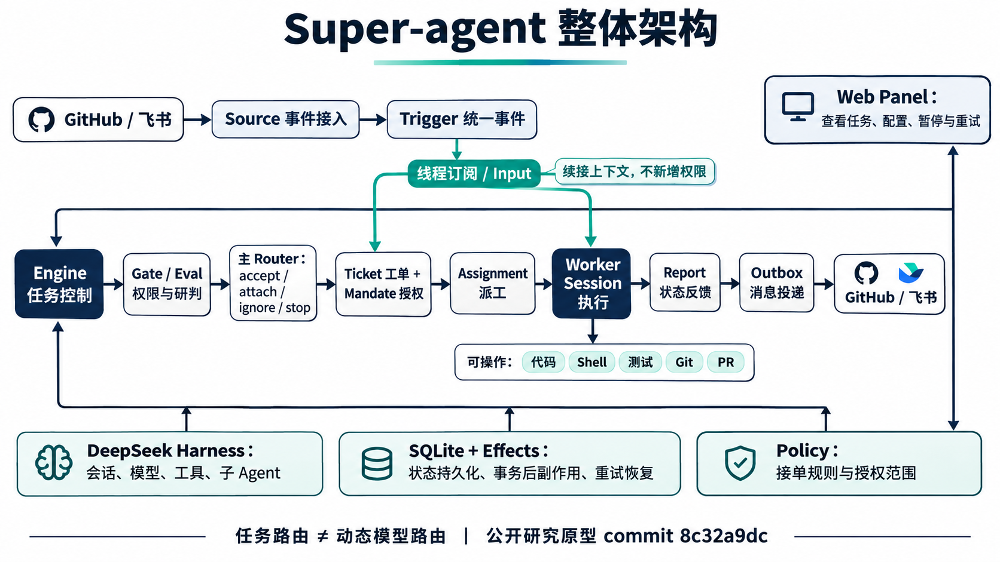
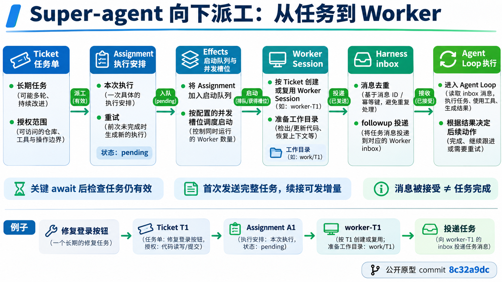
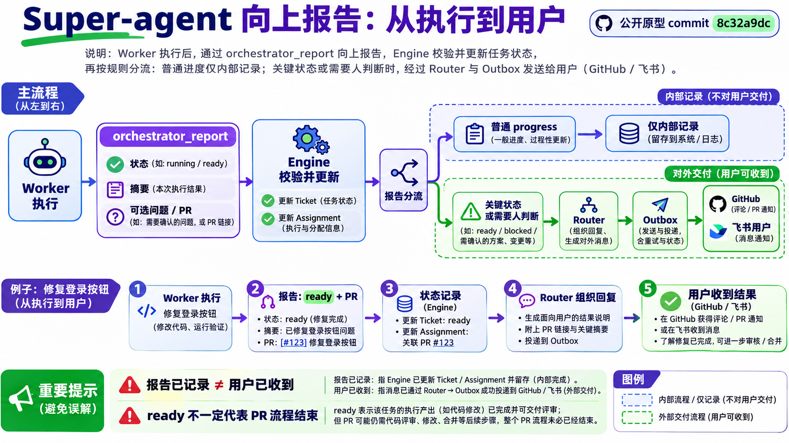
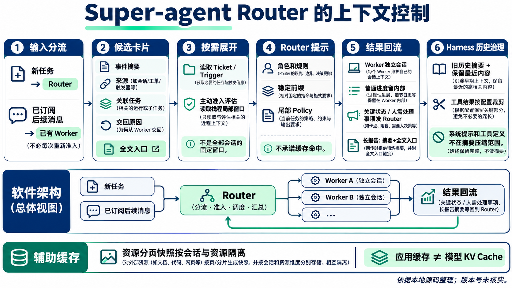
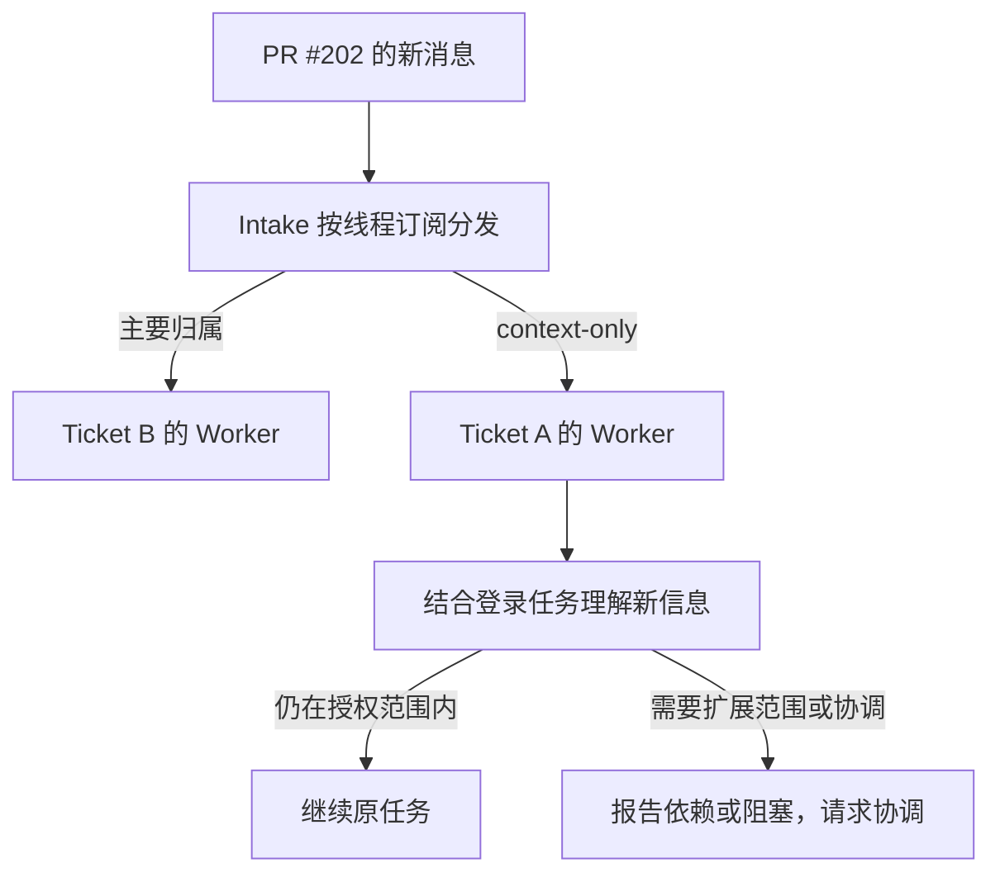

我一开始比较关心的是 Super-agent 怎么做任务路由。一个新问题进来，它怎么判断应该新建任务，还是接着已有任务继续做？如果同时有几个 Worker 在运行，新信息又应该发给谁？

讨论到这里，我感觉它和 dot 有一点相似：用户面对一个对话入口，内部却可以有多个任务分别运行。不过，界面上看起来相似，并不能说明内部实现也一样。要理解 Super-agent，还是得把任务如何建立、上下文如何保留、信息如何传递这几件事拆开。

其中一个我想继续追的问题是 Assignment。既然已经有 Ticket，也有 Worker Session，为什么还要在中间多放一层？直接把任务交给 Worker 不行吗？这个问题讲清楚，后面的派工、重试和结果归属就比较容易理解了。

> 本文基于公开研究原型 `dsh-superagent-prototype` 的固定提交 `8c32a9dc`，属于文档与静态源码分析，不是运行基准测试。项目 [README](https://github.com/deepseek-ai/dsh-superagent-prototype/blob/8c32a9dc5d72c033816c6a8110b37f40cf94fba4/README.md) 明确说明：它不是 DeepSeek 官方产品，也不等同于团队内部版本或设计文章中的全部方案。下文的实现描述只针对这个版本。
{: .prompt-info }

## 它主要解决的是人的注意力不够用吗？

可以这样理解，但还要往下问一步：为什么 Agent 多了，会消耗更多人的注意力？

比如我让一个 Worker 修登录问题，另一个 Worker 改鉴权接口。之后有人补充了需求，有人评论了 PR，还有一个 Worker 遇到了阻塞。如果每次都要我判断消息属于哪件事、转发给谁、要不要暂停另一个任务，那么执行虽然并行了，协调工作却仍然压在我身上。

Super-agent 要承担的就是其中一部分协调工作。它把外部消息归到具体任务，记录这件事允许做到哪里，再由对应的执行会话继续推进。这里的“路由”首先是任务和信息的归属，不是给每条请求挑一个模型。

减少人的注意力消耗，是这套设计的重要目标。但它不是让 Agent 随意主动做事。README 同时强调：只有被请求或被团队规则允许时才行动，只有人需要行动或结果确实有用时才发言。

所以，我和 dot 做的类比，主要对应“一个入口对接用户，内部管理多组工作会话”这一层。不过公开原型接入 GitHub，也可接入飞书，回复会回到原会话，并非所有工作都挤进唯一一个聊天窗口。

## Worker 是不是就相当于 Harness 的一个对话？

如果 Worker 本身已经能调用模型、读写代码，那 Super-agent 是另外做了一套 Harness，还是调用现成的运行时？可以先按职责区分：

| 层次 | 主要职责 |
| --- | --- |
| DeepSeek Harness | Agent 执行循环、会话、模型调用、工具系统、工作区及子 Agent 等基础能力 |
| Super-agent | 外部事件接入、任务归属、授权范围、调度、状态持久化、报告与对外回复 |
| Router | 在协调层中做需要模型判断的决策，例如接新任务、关联已有任务、处理交回的信息 |
| Worker | 在具体任务的会话与工作目录中执行工作，必要时使用 Harness 的子 Agent 能力 |

Super-agent 并不是重新实现一套完整的模型工具循环，也不是每收到任务就启动一个外部 Harness 命令行进程。

从 [插件入口](https://github.com/deepseek-ai/dsh-superagent-prototype/blob/8c32a9dc5d72c033816c6a8110b37f40cf94fba4/src/index.ts) 和 [Runtime 装配](https://github.com/deepseek-ai/dsh-superagent-prototype/blob/8c32a9dc5d72c033816c6a8110b37f40cf94fba4/src/app/runtime.ts) 可以看到，它以插件方式取得 Harness 提供的服务，再组装自己的 Engine、Sessions、Executor 等对象。创建 Worker 时，[Sessions](https://github.com/deepseek-ai/dsh-superagent-prototype/blob/8c32a9dc5d72c033816c6a8110b37f40cf94fba4/src/app/sessions.ts) 使用宿主的会话控制与工作区能力。

所以，“一个 Worker 像 Harness 中的一段独立对话”这个类比基本成立，但不完整：它还关联任务身份、执行尝试、工作目录和报告权限。**Session 不等于独立操作系统进程，独立目录也不等于强安全沙箱。**

> **图示阅读说明：** 这张是讨论时的整体架构演示图，主链路做了简化。图中的 Report → Outbox 不能理解为报告直接对外发送：实际还要经过 Engine 更新状态，并在必要时转给 Router 决定是否回复。Engine 也贯穿整个状态流转，不只是最左侧的一个步骤。
{: .prompt-warning }


_讨论时生成的演示图，保留原貌；请结合上方勘误与下文源码说明阅读。_

图中 Engine 不是另一个大模型。它承担的是确定性的状态与规则执行。模型提出动作，不代表动作可以绕过任务状态和授权约束。

## 为什么不直接 Ticket → Worker Session？

如果任务已经交给 Worker，为什么不直接做成 `Ticket → Worker Session`？

关键是这三个对象的生命周期不同：

| 对象 | 回答的问题 | 典型生命周期 |
| --- | --- | --- |
| Ticket | “我们到底在做哪件事，允许做什么？” | 一个持续推进的工作项 |
| Assignment | “现在是哪一次执行尝试？” | 一轮派工、运行与结束 |
| Worker Session | “执行者已经看过和做过什么？” | 可跨执行尝试保留的对话与运行上下文 |

假设 Ticket T1 是“修复登录刷新失败”。首次执行 A1 报告受阻，Router 后来显式发起重试，系统结束 A1 并创建 A2。任务仍然是 T1，也可能继续使用原 Worker Session，但这不是同一次执行。需要注意：blocked 报告本身并不结束 Assignment；若只是收到后续输入继续工作，也可能仍在 A1 内。

如果没有 Assignment，系统很难区分：

1. 同一条派工消息被重复投递；
2. 用户明确要求重新尝试；
3. A1 的异步操作迟到，而 A2 已经开始。

Assignment 为一次尝试提供身份，供调度和回调校验使用。它还让系统保留执行历史，而不用每次重试都丢掉 Worker 的上下文。

如果只用 Ticket ID，迟到的 A1 回调和正在执行的 A2 都属于 T1，系统还得另找办法分辨它们。Assignment 就把这个区别明确记录下来了；Session 则不必跟着每次尝试一起重建。相关实现可以从 [Ticket 调度逻辑](https://github.com/deepseek-ai/dsh-superagent-prototype/blob/8c32a9dc5d72c033816c6a8110b37f40cf94fba4/src/core/tickets.ts) 和 [DshExecutor](https://github.com/deepseek-ai/dsh-superagent-prototype/blob/8c32a9dc5d72c033816c6a8110b37f40cf94fba4/src/executor/dsh.ts) 顺着阅读。

### 什么时候新建任务，什么时候关联？

公开原型并没有一套训练好的“任务相似度分类器”。

[dispatch 提示词](https://github.com/deepseek-ai/dsh-superagent-prototype/blob/8c32a9dc5d72c033816c6a8110b37f40cf94fba4/prompts/dispatch.md) 对关联已有任务采取比较保守的策略：明确的 PR、Issue、来源引用，或能够唯一识别的已有工作，比“话题看起来类似”更有说服力。错误关联会把长期上下文和授权范围一起污染，因此不能只凭语义相似就合并任务。

模型负责判断，Engine 负责检查动作在当前状态下是否合法。它不是一个能保证语义判断永远正确的规则系统。

也要区分两种“多 Agent”：

- 多个 Ticket 对应多个任务 Worker，解决不同工作的生命周期与隔离问题。
- 一个 Worker 使用子 Agent，解决任务内部的分工问题。

后者并不意味着必须新建业务 Ticket。源码中也没有一个通用的复杂度阈值，能机械地决定“超过多少难度就启动多个 Agent”。

## 任务确定之后，怎样真正交给 Worker？

现在假设登录修复已经被接为 Ticket T1，也有了本次 Assignment。接下来还不能直接把它当成“正在执行”：系统需要准备目录、找到或创建会话，再把任务投进去。

> **图示阅读说明：** 图按职责分栏，便于理解，不是逐行执行时序。Effects 负责持久化执行意图，实际启动与并发槽位管理在 Executor；目录准备、会话建立和投递的先后以正文源码为准。图中“重试”指显式开启新尝试，不是报告 blocked 或 failed 后必然自动产生新 Assignment。
{: .prompt-warning }


_讨论时生成的演示图，保留原貌；请结合上方勘误与下文源码说明阅读。_

[启动代码](https://github.com/deepseek-ai/dsh-superagent-prototype/blob/8c32a9dc5d72c033816c6a8110b37f40cf94fba4/src/executor/dsh.ts#L424-L469) 中有几个值得注意的细节。

准备目录、创建会话都涉及异步步骤。这里需要反复确认一个问题：“我还是当前执行者吗？” 准备目录、等待旧运行结束、确保会话存在，都可能耗时。期间任务可能已停止或换了 Assignment，不能拿着旧状态继续投递。

还有一个细节是，复用会话不意味着每次重复发送完整任务。 第一次需要初始说明，后续尝试可以传递增量信息。相关消息还带有稳定的请求身份，便于识别是否已经进入会话。

最后，消息投递成功只代表执行可以开始，不代表任务完成。 消息被 Worker 接收，只能说明执行开始。代码修改是否正确、测试是否通过、是否需要人确认，要通过后续报告和验证来表达。

这些保护减少了异步执行中的重复和过期动作，但并不意味着已经发生的外部副作用能够自动撤回。

## Worker 的结果又怎么回到 Router？

登录问题修到一半，Worker 可能想报告进展，也可能需要人补充信息。它使用 [`orchestrator_report`](https://github.com/deepseek-ai/dsh-superagent-prototype/blob/8c32a9dc5d72c033816c6a8110b37f40cf94fba4/src/app/tools/executor.ts#L72-L102) 提交结构化报告，而不是把完整对话不断转发给 Router。

该版本工具支持的报告状态是：

- `progress`：进展；
- `ready`：结果已准备好；
- `blocked`：受阻；
- `failed`：失败；
- `dropped`：放弃。

这里没有 `running` 或 `waiting` 这两个报告枚举。调度状态与工具报告状态不能混用。

报告还可以携带摘要、需要人处理的事项、关联 PR，以及正在回应哪条输入。工具绑定当前 Worker 的 Ticket，避免模型随意替别的任务报告。

> **图示阅读说明：** 原图有两处状态表述需要更正：orchestrator_report 框内的 running 应为 progress（或 ready）；例子中的“Ticket: ready”应理解为任务收到 ready 报告，不能把报告枚举直接当成 Ticket 生命周期状态。绿色分支表示可能的对外交付路径，关键状态送到 Router 后并不保证每次发消息。只有 Outbox 实际发送成功，才能说用户已收到。
{: .prompt-warning }


_讨论时生成的演示图，保留原貌；请结合上方勘误与下文源码说明阅读。_

[报告转交通知](https://github.com/deepseek-ai/dsh-superagent-prototype/blob/8c32a9dc5d72c033816c6a8110b37f40cf94fba4/src/app/notices.ts#L107-L128) 会区分普通内部进度与需要 Router 处理的消息。摘要有长度控制，详细信息可以再读，不直接复制整段 Worker 历史。

这里有三个不同的完成点：

1. Worker 的报告被系统接受；
2. Router 收到并处理通知；
3. 外部回复真正送到原会话。

把第一步误当成第三步，会产生“Agent 以为已经告诉用户，但用户根本没收到”的问题。Outbox 的存在，就是为了让外部发送也成为可追踪的工作，而不是隐藏在一句自然语言承诺里。

## 多个 Worker 一起运行，Router 的上下文会不会越来越大？

如果 Router 要读完每个 Worker 的执行记录，再决定每条新消息怎么处理，那么多开几个 Worker，只是把上下文问题集中到了 Router 身上。压缩历史当然是一种办法，但在此之前，还可以先区分哪些消息需要它重新判断，哪些已经有明确去向。

> **图示勘误：** 下图底部总览把“已订阅后续消息”画成经过 Router 的箭头，这不是必经路径。Intake 可以直接投递给已有 Worker；人类后续消息仍可能通知 Router，以处理停止请求，而不是重新路由。普通进度“留内部”指可由系统内部记录，并不只存于 Worker 会话。此图来自当时读取的本地源码，未核实 Git 版本，不能视作固定提交的精确配置图。
{: .prompt-warning }


_图中六个方面用于理解上下文治理，不是每条输入都要依次经过的流水线。_

### 已经知道归属，还需要再问 Router 吗？

如果一个会话已经明确属于某个任务，后续输入可以由 Intake 按订阅关系投递，不必每条都请 Router 重新判断一次。

这种旁路减少了重复决策及其误关联机会。但它不保证后续消息完全不进入 Router 上下文：人类后续消息仍可被转告 Router，用于处理停止请求，而不是重新接单。Worker 发现输入超出任务范围时，也仍需要交回协调层，而不是擅自扩大工作。

### 确实需要判断时，先看多少信息？

需要判断时，Router 看到的是结构化线索：消息来源、线程关联、已有任务、已经交付给谁、是否被交回，以及可继续读取的引用。

这更像“索引加按需展开”，而不是把所有 PR 评论、历史工具输出和 Worker 对话预先塞进去。源码里存在特定场景的消息窗口与预览截断，但不能把它们理解成整个 Router 永远只保留固定几条消息。

### Worker 的执行记录要不要全部带回来？

Worker 各自保留执行上下文。Router 主要掌握任务关系、状态、问题和结果摘要；需要细节时再查询。否则每新增一个 Worker，主对话就要承担一份完整执行日志，协调者迟早变成上下文瓶颈。

### 剩下的上下文再怎样处理？

[提示词组装](https://github.com/deepseek-ai/dsh-superagent-prototype/blob/8c32a9dc5d72c033816c6a8110b37f40cf94fba4/src/app/prompts.ts) 把相对稳定的角色规则与动态内容组织起来，有利于减少不必要的前缀变化。但“有利于缓存复用”不等于已经测得某个缓存命中率。

此外，[Harness 配置](https://github.com/deepseek-ai/dsh-superagent-prototype/blob/8c32a9dc5d72c033816c6a8110b37f40cf94fba4/cordis.patch.yml) 启用了上下文压缩和工具结果裁剪。工具输出裁剪处理的是工具结果，不是把所有用户消息都按同一字符数截断。

分页读取的文本快照缓存也值得区分：[sourcePage](https://github.com/deepseek-ai/dsh-superagent-prototype/blob/8c32a9dc5d72c033816c6a8110b37f40cf94fba4/src/app/resources.ts#L103-L108) 在 `offset = 0` 时重新获取资源，并刷新同一 Session、同一资源对应的缓存；后续页通常复用当前快照。如果缓存已失效，需要从 `offset = 0` 重新读取。因此，它不是永不变化的分页快照，也与模型服务的 KV Cache 不是一回事。

所以这里并不只有“长了就做摘要”这一种处理。任务归属已经确定的，尽量不重复决策；细节留在 Worker，需要时再读取；对于仍然增长的会话，再使用宿主的压缩与裁剪能力。

## A 做到一半涉及 B，B 的新消息怎么送过来？

前面说了上下文分开，但任务并不总是独立的。这也是我在讨论中继续追问的场景：A 模块的 Worker 做到一半，发现代码涉及 B 模块，这时候 B 又有新消息，Router 怎么把信息交给这个已经在处理 A、B 关联问题的 Worker？

沿用登录和鉴权的例子，把任务关系具体化。下面的 PR 编号只用于讲解。

- Ticket A：修复登录刷新失败。
- Ticket B：修改鉴权接口，对应 PR #202。
- A 的 Worker 读代码后发现，它依赖 B 正在调整的接口。

首先，A 不会因为读到了 B 模块，就自动变成一个新的“AB Worker”。Worker 对应的是任务，不是固定的代码模块。

如果 A 需要持续知道 PR #202 的变化，可以调用：

```text
orchestrator_thread_follow({
  thread: "github:202",
  reason: "登录修复依赖该 PR 的鉴权接口变化"
})
```

[Worker 订阅工具](https://github.com/deepseek-ai/dsh-superagent-prototype/blob/8c32a9dc5d72c033816c6a8110b37f40cf94fba4/src/app/tools/executor.ts#L53-L68) 与 [followForContext](https://github.com/deepseek-ai/dsh-superagent-prototype/blob/8c32a9dc5d72c033816c6a8110b37f40cf94fba4/src/core/tickets.ts#L402-L421) 会记录这种上下文关系。之后 PR #202 有新输入，[Intake](https://github.com/deepseek-ai/dsh-superagent-prototype/blob/8c32a9dc5d72c033816c6a8110b37f40cf94fba4/src/core/intake.ts#L30-L59) 按订阅分发：



这里最重要的不是“两个 Worker 都收到了”，而是它们收到的信息性质不同。

B 是主要归属；A 收到的是背景上下文。**知道一件事，不代表被授权去做那件事。** 订阅也不等于自动回放该线程全部历史，更不是把已结束的任务无条件复活。A 可以报告依赖或阻塞、请求协调，但这不同于 handback 原消息：A 不拥有 B 的输入，不能借此把 B 正在处理的消息重新派工。

如果只想临时补一句相关信息，Router 可以使用任务 note；但一次 note 不是长期订阅，也不能代替明确授权。持续关注、一次补充、重新派工，是三种不同的动作。

这也回答了一个容易误解的问题：关联消息不必总由 Router 逐条转发。订阅建立之后，确定性的 Intake 分发可以直接把信息送到相关 Worker。

## 这些 Agent 之间用的是 A2A 吗？

从本文检查的主要路径看，不是标准 A2A 协议。

Super-agent 的 Router 与 Worker，通过同一套应用状态、工具调用、会话投递与 inbox 机制协作。Worker 的报告先变成应用中的 Report，再由 Engine 决定是否转交通知；不是两个自治服务通过 A2A 交换任务卡片。

Worker 内部调用 Harness 子 Agent 时，则使用 Harness 的子 Agent 管理与消息工具。那是另一层父子 Agent 协作，不能和 Super-agent 的 Ticket/Assignment 混为一谈。

因此可以区分：

- **协调层通信**：围绕任务状态、派工与报告；
- **执行层通信**：围绕子 Agent、消息投递与执行结果；
- **跨系统协议**：例如不同厂商或不同服务之间的 A2A。

前两者不需要因为“有多个 Agent”就自动采用第三者。这里的结论也仅针对已检查的路径，不是断言 Harness 的所有扩展都不可能支持其他协议。

## 除了这些对象划分，代码还做了哪些处理？

流程正常走完时，几层转发看起来有些绕。但如果把重试、重启和迟到的回调放进来，就能看出其中一些代码的必要性。下面这些机制处理的不是“模型够不够聪明”，而是一次已经做出的决定怎样可靠地执行下去。

| 机制 | 要避免的问题 | 不能据此声称什么 |
| --- | --- | --- |
| 输入按已知归属旁路投递 | 每条消息都重新路由 | 所有输入都无需模型判断 |
| 稳定消息身份、历史与 inbox 检查 | 重启或重试后重复派工 | 分布式 exactly-once 已被证明 |
| 当前 Assignment 校验 | 旧执行回调污染新执行 | 所有外部副作用可回滚 |
| 持久化 Effects 与代际检查 | 旧完成回调误删新任务 | 任意故障下永不丢消息 |
| Worker 名额预留与唤醒顺序 | 并发启动竞态、任务饥饿 | 所有情形都严格等于一个总并发上限 |
| 按任务绑定工具与读写校验 | Worker 越过其他任务身份 | 操作系统级安全隔离 |

例如 [Effects 队列](https://github.com/deepseek-ai/dsh-superagent-prototype/blob/8c32a9dc5d72c033816c6a8110b37f40cf94fba4/src/app/effects.ts) 对同类同键的待执行效果做合并，并用序号、代际等条件确认完成。这样，旧异步操作结束时，不会简单把后来更新过的效果一起删除。

[Delivery](https://github.com/deepseek-ai/dsh-superagent-prototype/blob/8c32a9dc5d72c033816c6a8110b37f40cf94fba4/src/app/delivery.ts) 检查历史与 inbox，再结合当前任务状态投递；[Outbox](https://github.com/deepseek-ai/dsh-superagent-prototype/blob/8c32a9dc5d72c033816c6a8110b37f40cf94fba4/src/app/outbox.ts) 则把外部发送的排队与记录纳入状态处理。它们解决的是常见竞态与恢复问题，不应被夸大成普遍的“恰好一次执行”保证。

权限也要分层看。Router 主要使用协调工具，Worker 主要使用执行工具，但 Router 并非完全没有 shell 能力。具体能力还受角色预设、工具注册与运行环境共同影响，不能只看某一张白名单。

[部署文档](https://github.com/deepseek-ai/dsh-superagent-prototype/blob/8c32a9dc5d72c033816c6a8110b37f40cf94fba4/docs/006-deployment.md) 提醒两种预设以操作者 OS 用户运行，默认使用 `danger-full-access`。任务边界与工作目录隔离，是工程组织方式，不是安全沙箱。

### 这算小模型优化吗？

更短的上下文、明确的任务卡片和收敛的工具职责，可能让模型更容易完成工作。但这是合理推测，不是小模型能力已经被验证的结论。

公开原型支持按角色配置模型，[角色模型初始化逻辑](https://github.com/deepseek-ai/dsh-superagent-prototype/blob/8c32a9dc5d72c033816c6a8110b37f40cf94fba4/src/app/role-models.ts) 也会考虑已有会话选择。它不等于一个按任务难度自动选大小模型的 Router。

在本文检查的材料中，没有找到专门蒸馏、LoRA、小模型专用训练，或强弱模型自动升级与消融实验的完整证据。

## 怎么验证这套设计真的有效，而不只是看起来合理？

这是我最后还想追问的问题。任务、会话和执行尝试分开，确实能解释一些工程问题，但多了这些层，究竟能不能让人少操心、让任务更快完成，仍然需要验证。

仓库中的测试覆盖任务状态、后续输入、并发与角色配置等行为，README 提供 `pnpm check` 运行类型检查、测试和构建。这类测试可以帮助验证确定性规则，却不能直接证明模型总能正确理解用户、合理拆分任务，或者写出更高质量的代码。

设计文章中讨论的模拟与内部使用，也需要和公开原型分开。不能把协调实验直接外推成真实研发胜率，更不能据此宣布它胜过所有同类产品。

要回答“比其他产品更好吗”，至少还需要比较四类指标：

1. **任务效果**：真实任务完成率、代码正确性、返工率。
2. **协调质量**：错误关联率、重复执行率、跨任务信息遗漏率。
3. **人的负担**：人工介入次数、无效通知数、恢复一次失败所需时间。
4. **成本与延迟**：总 token 成本、端到端耗时、并发增加后的尾延迟。

比较还需要相同模型、工具权限、任务集与预算，并单独消融旁路投递、独立会话、订阅和摘要机制。否则性能变化究竟来自模型、提示词还是架构，很难分清。

这里列的是进一步评测需要回答的问题，不是项目已经完成这些实验的声明。

## 回到最初的问题

现在再看“Super-agent 这个 Agent，是不是就是任务路由机制”，我的理解是：Router 确实是其中重要的一部分，但只看 Router 还不够。

Router 决定一条新请求怎样处理之后，Ticket 要保留任务身份，Assignment 要区分执行尝试，Worker Session 要接着之前的上下文工作。之后如果别的任务有新信息，还需要订阅和投递机制把它送过来。任何一环只靠对话里的约定，重试或并发时都可能对不上。

因此，比起先问“该用几个 Agent、分别用什么模型”，这次讨论让我更想弄清楚的是：新消息属于哪件事，执行到哪一步，谁有权继续，以及需要人介入时究竟有没有通知到人。Super-agent 的公开原型给出了一套具体实现，但它是否值得用于某个实际项目，还要结合任务规模和验证结果判断。

## 阅读入口

以下 Super-agent 链接均固定到本文分析版本，便于对照，不随主分支变化：

- [README：定位与公开原型边界](https://github.com/deepseek-ai/dsh-superagent-prototype/blob/8c32a9dc5d72c033816c6a8110b37f40cf94fba4/README.md)
- [领域模型](https://github.com/deepseek-ai/dsh-superagent-prototype/blob/8c32a9dc5d72c033816c6a8110b37f40cf94fba4/docs/001-domain.md)、[授权](https://github.com/deepseek-ai/dsh-superagent-prototype/blob/8c32a9dc5d72c033816c6a8110b37f40cf94fba4/docs/002-authorization.md)、[执行](https://github.com/deepseek-ai/dsh-superagent-prototype/blob/8c32a9dc5d72c033816c6a8110b37f40cf94fba4/docs/003-execution.md)、[架构](https://github.com/deepseek-ai/dsh-superagent-prototype/blob/8c32a9dc5d72c033816c6a8110b37f40cf94fba4/docs/007-architecture.md)
- [任务派发规则](https://github.com/deepseek-ai/dsh-superagent-prototype/blob/8c32a9dc5d72c033816c6a8110b37f40cf94fba4/prompts/dispatch.md)
- [Ticket 生命周期与上下文订阅](https://github.com/deepseek-ai/dsh-superagent-prototype/blob/8c32a9dc5d72c033816c6a8110b37f40cf94fba4/src/core/tickets.ts)
- [Worker 启动与投递](https://github.com/deepseek-ai/dsh-superagent-prototype/blob/8c32a9dc5d72c033816c6a8110b37f40cf94fba4/src/executor/dsh.ts#L424-L469)
- [Worker 工具与报告](https://github.com/deepseek-ai/dsh-superagent-prototype/blob/8c32a9dc5d72c033816c6a8110b37f40cf94fba4/src/app/tools/executor.ts)
- [会话管理](https://github.com/deepseek-ai/dsh-superagent-prototype/blob/8c32a9dc5d72c033816c6a8110b37f40cf94fba4/src/app/sessions.ts)、[消息投递](https://github.com/deepseek-ai/dsh-superagent-prototype/blob/8c32a9dc5d72c033816c6a8110b37f40cf94fba4/src/app/delivery.ts)、[报告通知](https://github.com/deepseek-ai/dsh-superagent-prototype/blob/8c32a9dc5d72c033816c6a8110b37f40cf94fba4/src/app/notices.ts)
- [Intake](https://github.com/deepseek-ai/dsh-superagent-prototype/blob/8c32a9dc5d72c033816c6a8110b37f40cf94fba4/src/core/intake.ts)、[Effects](https://github.com/deepseek-ai/dsh-superagent-prototype/blob/8c32a9dc5d72c033816c6a8110b37f40cf94fba4/src/app/effects.ts)、[Outbox](https://github.com/deepseek-ai/dsh-superagent-prototype/blob/8c32a9dc5d72c033816c6a8110b37f40cf94fba4/src/app/outbox.ts)
- [DeepSeek Harness 子 Agent 文档](https://github.com/deepseek-ai/deepseek-harness/blob/fcc0ad462172522aaf5c93a7b2e01f6b9f0b0159/packages/subagent/subagent/README.md)

Harness 链接使用另一个固定提交，仅用于理解其子 Agent 机制；不代表本文已验证它与该 Super-agent 原型的版本兼容性。
